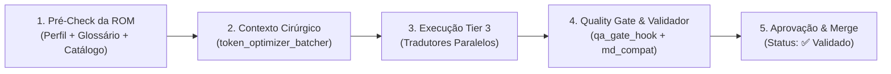

# ⚡ Skill: Sprint de Tradução Multi-Agente (`gba-translate-sprint`)

Este playbook aplica o fluxo de estúdio do *Claude-Code-Game-Studios* combinado com o [Protocolo Mestre de Tradução](../../02_TRADUCAO_ROMS_GBA/protocolo_traducao/PROTOCOLO_MESTRE_TRADUCAO.md) para traduzir lotes de qualquer ROM com máxima qualidade literária, zero estouro de memória/tela e compatibilidade total com o App Validador.

## 🔄 Fluxo Operacional da Sprint



### Passo 1: Pré-Check de Engenharia e Contexto do Jogo (Tier 1 & Tier 2)
Antes de traduzir o arquivo `.md` alvo:
1. Leia `project_profile.json` e `docs/REGRAS_ESPECIFICAS_DO_JOGO.md` do jogo ativo para carregar o `hard_limit`, `soft_limit`, `gender_mode` e particularidades daquela ROM.
2. Leia os termos relevantes no **Glossário Global Soberano do Jogo** (`ARQUIVOS md/02-glossario-*.md`) e no Glossário da Série (em *Summon Night*, ***Summon Night: Swordcraft Story 1* (GBA)** é a matriz soberana que manda em todas as referências gerais; os demais jogos herdam a base do primeiro e apenas adicionam termos novos).
3. Consulte as vozes dos falantes presentes no arquivo em `ARQUIVOS md/catalogo-de-personagens.md`.
4. Se o arquivo tiver mais de 60 linhas pendentes, use `token_optimizer_batcher.py` para gerar blocos enxutos de 35-50 falas ou dividir por faixas de linhas entre subagentes (`gba-dialogue-translator`).

### Passo 2: Diretrizes Obrigatórias Durante a Tradução (Tier 3)
Ao preencher a coluna `Tradução Sugerida (PT-BR)`:
1. **Ciclo de Vida dos Termos (Introdução por Extenso ➔ Forma Abreviada nos Diálogos):**
   - Use o termo inteiro na **1ª Apresentação / Lore / Cerimônia** e a forma abreviada natural nos **Diálogos Cotidianos**:
     - `Craftknight > Cavaleiro Forjador > Cavaleiro` *(ou Cavaleira)*
     - `Craftlord > Lorde Forjador > Lorde` *(ou Mestre / Mestra)*
     - `Stray Summon > Invocação Errante > Errante`
     - `Guardian Beast > Fera Guardiã > Fera Guardiã / Guardião / Parceiro`
2. **Limite Físico de Tela (`project_profile.json`):** Mantenha cada linha entre `<br>` idealmente dentro do `ideal_limit` (padrão **1 a 32 chars**), respeitando o `soft_limit` (**33-35 chars**) e jamais ultrapassando o `hard_limit` calibrado para a ROM (padrão **35 chars**).
3. **Neutralidade de Gênero para `{PLAYER}`:** Quando `gender_mode` for `selectable_neutral`, jamais use adjetivos masculinos/femininos diretos para o protagonista compartilhado. Use construções com substantivos (*"Você tem muita coragem!"*, *"O cansaço bateu?"*, *"Boas-vindas!"*, *"Agradeço de coração!"*).
4. **Zero Inglês Residual:** Traduza todos os termos comuns e compostos (*Guilda Prateada*, *Torre Central*, *Cidade das Espadas*, *Água de Silturn*, *Cura da Mariel*), mantendo no original apenas nomes próprios de pessoas e continentes/cidades puras.
5. **Política de Abreviações:**
   - **Diálogos de História:** Zero abreviações telegráficas (`vc`, `tb`, `pq`, `atq.` são estritamente proibidos).
   - **Menus e Itens (`03-` a `07-`):** Use a Tabela Canônica (`ATQ`, `DEF`, `AGI`, `DUR`, `HP`, `MP`, `TEC`, `Recup.`, `Esp.`, `Mach.`, `Lanç.`, `Soq.`, `Broc.`, `Min.`, `Nv.`, `A`).
6. **Prevenção de Orfandade:** Nunca termine uma linha antes de `<br>` com monossílabos soltos (`o`, `a`, `de`, `do`, `da`, `em`, `e`, `que`).

### Passo 3: Passagem Obrigatória pelo Quality Gate & Certificador do App Validador (Tier 2/3)
Assim que terminar a tradução do lote/arquivo, **sempre** execute os dois auditores automatizados:
```powershell
python "02_TRADUCAO_ROMS_GBA/protocolo_extracao/tools/qa_gate_hook.py" "<caminho_do_arquivo.md>"
python "02_TRADUCAO_ROMS_GBA/protocolo_extracao/tools/md_validator_compat_check.py" "<caminho_do_arquivo.md>"
```
- Se qualquer erro `🔴` for apontado (estouro de caracteres, tag `{PLAYER}` faltando, abreviação proibida ou coluna desalinhada para o App Validador), **reescreva imediatamente as linhas sinalizadas** e rode os comandos de novo até obter `🏆 QUALITY GATE APROVADO!` e `🏆 CERTIFICADO!`.
